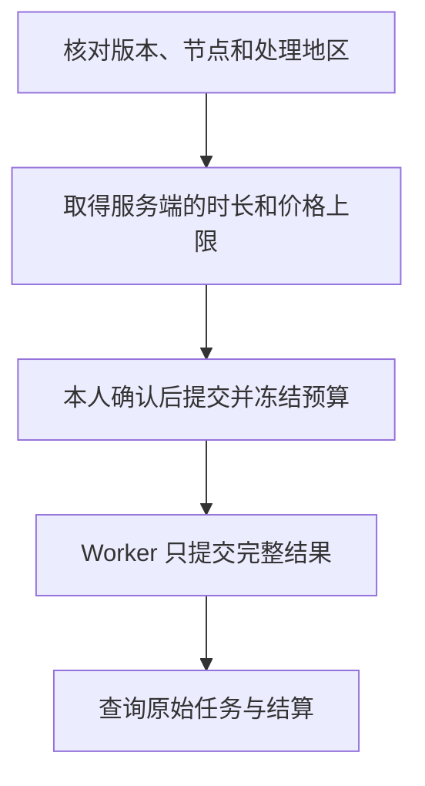
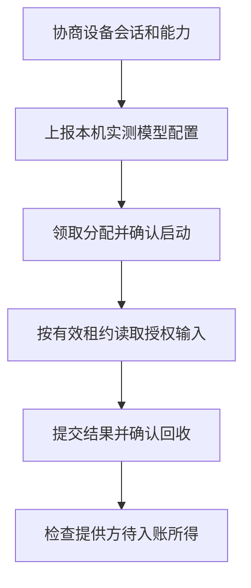
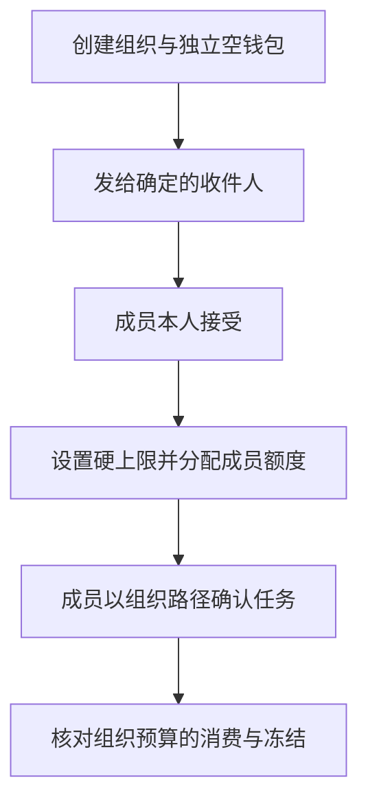
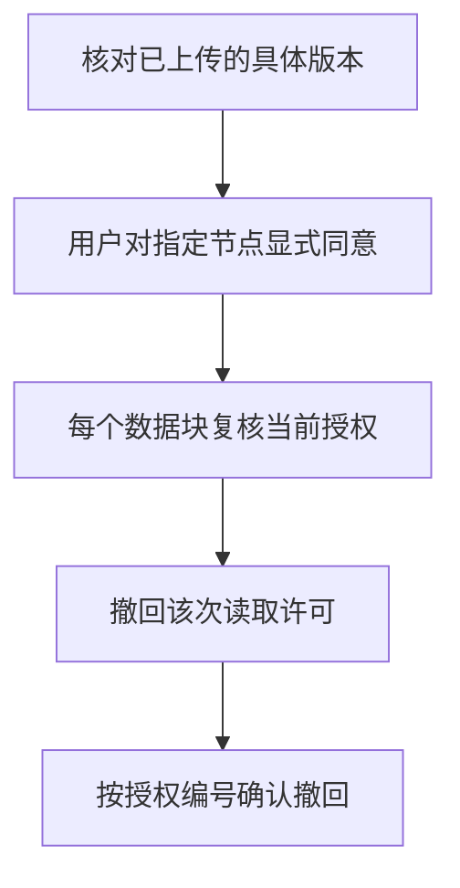
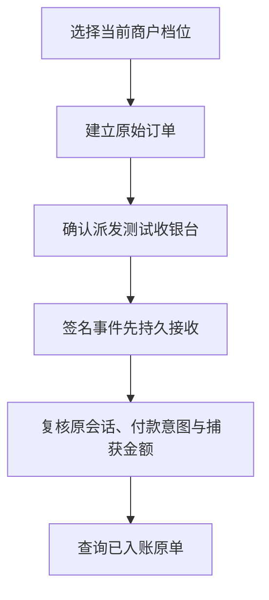
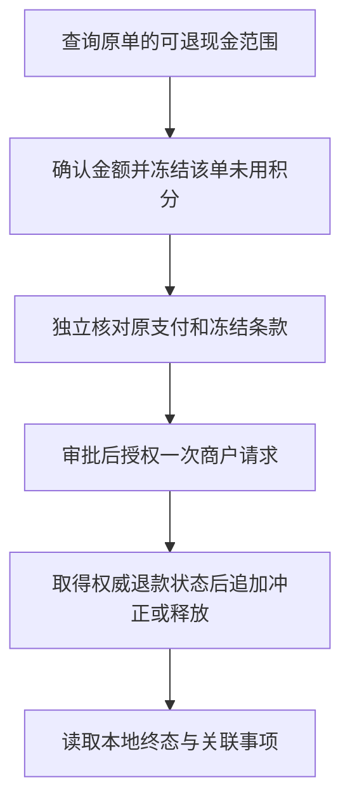

# 六条核心用户流程

这些流程区分个人、组织、提供方设备和平台操作员。示例中的现金使用测试商户协议，微积分使用开发账本。业务是否完成由原编号对应的服务端状态确认。

## 租用算力

当前购买账户的原始提交人发起这项流程。拥有可用预算与余额，已取得所选源、节点和配置的授权。

入口为 `POST /api/v1/owners/{owner}/transcription-quotes`。完成后通过 `GET /api/v1/owners/{owner}/jobs/{job}` 核对 `execution_state`, `settlement_state`, `charge`。

| 操作 | 对应接口 |
|---|---|
| 核对版本、节点和处理地区 | `GET /api/v1/transcription-targets/{id}` |
| 取得服务端的时长和价格上限 | `POST /api/v1/owners/{owner}/transcription-quotes` |
| 本人确认后提交并冻结预算 | `POST /api/v1/owners/{owner}/jobs` |
| Worker 只提交完整结果 | `WorkerGateway.CommitOutput` |
| 查询原始任务与结算 | `GET /api/v1/owners/{owner}/jobs/{job}` |

| 退出情况 | 可观察状态 | 资金影响 | 恢复入口 |
|---|---|---|---|
| 取消 | 排队时取消；运行中等待清理。 | 排队预留全退；已交付按原事实结算。 | 按 Job 编号查询状态及原分桶。 |
| 无权限 | 原用户授权、组织或预算权限不成立。 | 被拒绝的新请求不产生预留。 | 恢复合法授权后读取原调用编号。 |
| 不可用 | 没有可用价格、预算不足或源不可读。 | 报价不扣款；被拒绝的提交不冻结。 | 重新读取来源、额度与报价。 |
| 结果未知 | 提交响应丢失。 | 原请求可能已冻结。 | 按原 invocation 查询，恢复原 Job。 |

## 提供空闲算力

已登记设备与其提供方账户发起这项流程。设备启用本地贡献，审核模型、证书、当前策略和本地 Broker 均有效。

入口为 `WorkerGateway.Control`。完成后通过 `GET /api/v1/account/wallet` 核对 `owner_id`, `pending_earned`。

| 操作 | 对应接口 |
|---|---|
| 协商设备会话和能力 | `WorkerGateway.Control` |
| 上报本机实测模型配置 | `WorkerGateway.ReportTranscriptionObservation` |
| 领取分配并确认启动 | `WorkerGateway.Control` |
| 按有效租约读取授权输入 | `WorkerGateway.ReadTranscriptionInput` |
| 提交结果并确认回收 | `WorkerGateway.ConfirmCpuCleanup` |
| 检查提供方待入账所得 | `GET /api/v1/account/wallet` |

| 退出情况 | 可观察状态 | 资金影响 | 恢复入口 |
|---|---|---|---|
| 取消 | 进入停止或排空，等待进程退出证明。 | 未交付不会增加提供方收益。 | 按原租约和清理回执核对槽位。 |
| 无权限 | 证书失效、旧会话或租约不匹配。 | 拒绝读取或发布，无新收益。 | 重新登记或重新协商受信会话。 |
| 不可用 | 设备忙或模型资格未通过。 | 没有实际分配时无收费。 | 恢复设备后重新报告实际能力。 |
| 结果未知 | 结果发送后回执丢失。 | 服务端可能已经记录收益。 | 按原输出摘要查询回执，不再运行推理。 |

## 使用团队额度

组织 Owner、获授权的 Admin 与真正接受邀请的成员发起这项流程。用户已注册；Owner 有当前组织权限，组织账户已独立获得资金。

入口为 `POST /api/v1/organizations`。完成后通过 `GET /api/v1/organizations/{id}/budgets/{budget}` 核对 `organization_id`, `member_id`, `spent`, `reserved`。

| 操作 | 对应接口 |
|---|---|
| 创建组织与独立空钱包 | `POST /api/v1/organizations` |
| 发给确定的收件人 | `POST /api/v1/organizations/{id}/invitations` |
| 成员本人接受 | `POST /api/v1/team-invitations/{invitation}/accept` |
| 设置硬上限并分配成员额度 | `POST /api/v1/organizations/{id}/budgets` |
| 成员以组织路径确认任务 | `POST /api/v1/owners/{owner}/jobs` |
| 核对组织预算的消费与冻结 | `GET /api/v1/organizations/{id}/budgets/{budget}` |

| 退出情况 | 可观察状态 | 资金影响 | 恢复入口 |
|---|---|---|---|
| 取消 | 邀请可撤回或拒绝；已提交任务使用原 Job 取消。 | 邀请与分配额度均不创造余额。 | 读取组织邀请、成员清单及预算。 |
| 无权限 | 成员移除或降为 Billing 时旧提交授权撤销。 | 已记账费用和原组织归属保留。 | 由有权经理重新明确分配。 |
| 不可用 | 成员数达到上限或额度总和超过硬上限。 | 失败的分配不占额度，也不影响个人钱包。 | 刷新成员数、已分配额度和策略版本。 |
| 结果未知 | 发出邀请或配置额度后连接中断。 | 治理请求本身不扣积分。 | 用原编号复核，确认只存在一份邀请或预算。 |

## 授权和撤回远程输入

拥有源版本读取、写入及预算提交权限的当前用户发起这项流程。已上传并测量准确版本，可向用户展示接收节点、地区、模型、语言和时限。

入口为 `POST /api/v1/owners/{owner}/transcription-input-grants`。完成后通过 `GET /api/v1/owners/{owner}/transcription-input-grants/{id}` 核对 `state`, `expires_at_unix`, `projection_digest`。

| 操作 | 对应接口 |
|---|---|
| 核对已上传的具体版本 | `POST /api/v1/owners/{owner}/uploads/{upload}/transcription-measurements` |
| 用户对指定节点显式同意 | `POST /api/v1/owners/{owner}/transcription-input-grants` |
| 每个数据块复核当前授权 | `WorkerGateway.ReadTranscriptionInput` |
| 撤回该次读取许可 | `DELETE /api/v1/owners/{owner}/transcription-input-grants/{id}` |
| 按授权编号确认撤回 | `GET /api/v1/owners/{owner}/transcription-input-grants/{id}` |

| 退出情况 | 可观察状态 | 资金影响 | 恢复入口 |
|---|---|---|---|
| 取消 | 提交前撤回可抢先建立撤回记录。 | 单独签发授权不扣款。 | 按原授权编号确认状态。 |
| 无权限 | 源被删除、共享撤销或设备不匹配。 | 没有已提交结果时不计算交付收入。 | 查询源状态与原任务的冻结及清理状态。 |
| 不可用 | 源字节损坏或解码证据不一致。 | 拒绝输出；已冻结的任务按回收证据结算。 | 重新验证原版本，不能用同名文件替换证据。 |
| 结果未知 | 授权或撤回响应丢失。 | 授权恢复不自动创建收费任务。 | 读取原 grant；按原编号重试撤回。 |

## 充值购买积分

个人用户或具有组织 Owner、Billing 权限的用户发起这项流程。测试商户和固定档位已启用；当前页面清楚列示现金最小单位和将入账的购买微积分。

入口为 `POST /api/v1/owners/{owner}/checkout-orders`。完成后通过 `GET /api/v1/owners/{owner}/checkout-orders/{order}` 核对 `order_id`, `owner_id`, `offer`, `state`。

| 操作 | 对应接口 |
|---|---|
| 选择当前商户档位 | `GET /api/v1/owners/{owner}/credit-offers` |
| 建立原始订单 | `POST /api/v1/owners/{owner}/checkout-orders` |
| 确认派发测试收银台 | `POST /api/v1/owners/{owner}/checkout-orders/{order}/session` |
| 签名事件先持久接收 | `POST /api/v1/payment-events/stripe-test` |
| 复核原会话、付款意图与捕获金额 | `POST /api/v1/owners/{owner}/checkout-orders/{order}/reconcile` |
| 查询已入账原单 | `GET /api/v1/owners/{owner}/checkout-orders/{order}` |

| 退出情况 | 可观察状态 | 资金影响 | 恢复入口 |
|---|---|---|---|
| 取消 | 尚未向商户派发的订单可取消。 | 未派发无现金或积分变动。 | 已派发则查询原单，不把浏览器返回当取消。 |
| 无权限 | 财务角色撤销或回调签名不符。 | 拒绝派发或入账。 | 由原账户合法主体重新读取。 |
| 不可用 | 商户不可达，或现金金额、币种、档位不匹配。 | 未核实的支付不能增加购买余额。 | 查原会话和独立财务凭证。 |
| 结果未知 | 会话创建请求发出后失去回应。 | 可能有商户会话，平台不重复创建。 | 原订单与可信事件可恢复会话，再查询原付款事实。 |

## 原路部分退款

原购买账户的获权财务主体、制单人和独立审批人发起这项流程。原购买已确认入账，尚有来自该单的可退积分和现金额度。

入口为 `GET /api/v1/owners/{owner}/checkout-orders/{order}/refundable`。完成后通过 `GET /api/v1/owners/{owner}/refunds/{refund}` 核对 `refund_id`, `order_id`, `state`, `held_microcredits`。

| 操作 | 对应接口 |
|---|---|
| 查询原单的可退现金范围 | `GET /api/v1/owners/{owner}/checkout-orders/{order}/refundable` |
| 确认金额并冻结该单未用积分 | `POST /api/v1/owners/{owner}/checkout-orders/{order}/refunds` |
| 独立核对原支付和冻结条款 | `GET /admin/v1/test-refunds/{case_id}` |
| 审批后授权一次商户请求 | `POST /admin/v1/actions/{action_id}/execute` |
| 取得权威退款状态后追加冲正或释放 | `POST /api/v1/payment-events/stripe-test` |
| 读取本地终态与关联事项 | `GET /api/v1/owners/{owner}/refunds/{refund}` |

| 退出情况 | 可观察状态 | 资金影响 | 恢复入口 |
|---|---|---|---|
| 取消 | 未派发的申请可取消。 | 沿原单释放冻结，已发出的外部退款继续核对。 | 按原 refund_id 读取。 |
| 无权限 | 申请人自批、审批角色撤销或范围不符。 | 不能据此派发商户退款。 | 核对审批记录，未派发时可取消原申请。 |
| 不可用 | 原单余额已消费、被任务占用，或商户证据不一致。 | 不能挪用赠送、贡献或另一单的余额。 | 核对原购买分桶与商户现金凭证。 |
| 结果未知 | 商户接收退款后响应丢失。 | 保留原冻结，不发起第二次退款。 | 依据原 Charge 和派发标记定位同一 Refund，终态只记一次。 |

## 演练

完整的本机演练使用同一组个人账户、组织钱包、两个分别登记的 CPU 节点和两个独立的测试财务身份。服务端通过真实用户接口履约，支付与退款的商户端仅为本地协议替身。独立的模型进程对公开录音进行实际推理。使用 `python3 scripts/check-transcription-input-grants.py --six-journeys-only --web-repo ../orange-agent-web` 运行；浏览器购买端与管理端的故障分支通过 `scripts/check-test-checkout.py` 单独验证。
