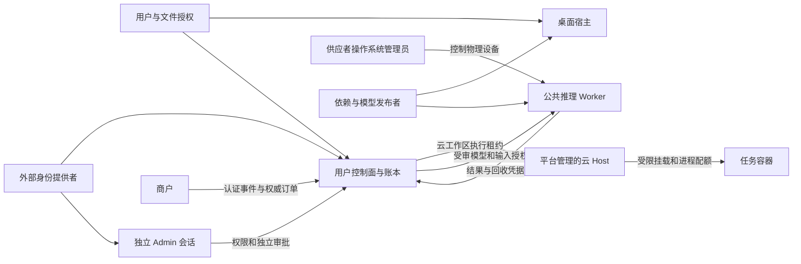

# 首版安全设计评审

**资金。** 用户、团队、平台及供应者拥有不同账本权益。付款回调只作为核验线索，入账依赖受支持的订单、币种、原子账本和幂等所有权。开发验收使用隔离的商户协议夹具和本地 PostgreSQL。真实商户资格、公开收费与争议处置需要独立凭据。

**隐私。** 设备管理员掌握主机内存和驱动。普通任务进程只持有本次操作获批的输入和工作目录。公共推理存在主机读取明文的剩余风险，用户可在授权前查看目的地和费用。撤权阻止后继平台访问，已发送数据的物理副本不能由控制面回收。运营查询由当前会话、角色与范围共同决定。用户令牌和运营权限分属不同信任域。

**主机。** 公共 Worker 只运行已审核推理配置。托管工具执行使用平台管理的隔离池。进程重启后，执行日志和资源所有权共同决定能否再分配。模型摘要验证与缓存发布分开；获准的模型身份不代表每个目标平台的驱动已通过测试。

[风险和控制登记](trust-model.json) 为每项暴露面列明业务影响、控制、负责工程、实际代码位置、验收入口与剩余风险。首版门禁包含输入、凭证、资源重用、资金、模型来源和供应者明文暴露。G6 多卡、跨域故障和长期观察继续单列。自动设计走查和开发环境实测不能代替法务批准、真实供应者准入、企业试点、签名或人工独立审批。

## 重现实测

在服务端根执行 `python3.12 scripts/check-security-design.py --section review`。可用 `--private-dir` 指向开发环境目录，其中包含本机测试库的连接文件、开发身份配置和固定版本的 gVisor 归档。不传递生产凭据。命令实际运行截断输入、模型校验失败、Worker 锁/未知状态/旧授权、过期 Admin 身份、当前 mTLS 输入授权与开发商户重复履约用例，并在本机 Linux 虚拟机运行受限工作负载。只需检查资产或设计责任时，分别使用 assets、exposure 或 controls。

Worker 验收默认同时运行两个独立用例。用例内部的抢占、撤权和重放仍按原并发路径执行。高扇出运行的抖动另外记录，开发通过率不代表高负载下的可用性。
