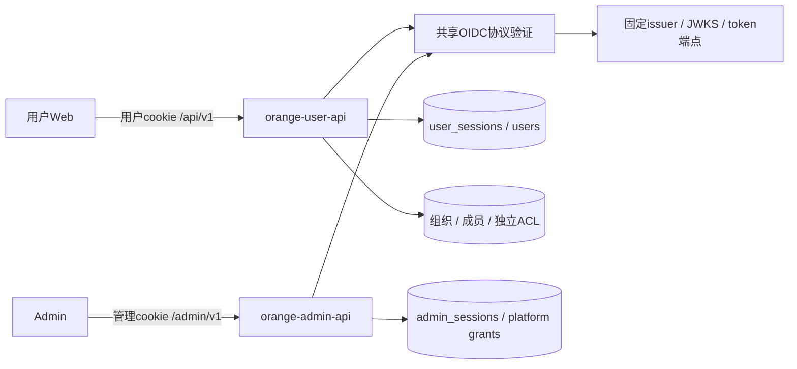

# 普通用户身份与组织接口

2026-11-04；关联CP-001/002。共享的是OIDC验证原语，用户和Admin的client、回调、cookie、数据库会话和权限保持独立。

OIDC处理统一使用固定openidconnect组件：Authorization Code、S256 PKCE、nonce/state、issuer/audience/签名/有效期/at_hash和配置的ACR。一次性交换状态分别存入user_auth_flows与admin_auth_flows。返回的VerifiedIdentity不能从JSON反序列化构造；权限不会来自令牌里的角色名。

用户客户端orange-user在本地使用已验证的密码等级ACR1；Admin仍要求实际密码＋TOTP对应的ACR2。Cookie分别为`__Host-orange-user`和`__Host-orange-admin`，均Secure/HttpOnly/SameSite=Lax/Path=/且无Domain。用户cookie改名为管理cookie仍无法匹配管理会话；两类来源的CSRF/Origin也不互通。

首次真实用户登录按issuer/subject建立固定用户身份和独立零余额个人owner/wallet；并发登录通过数据库锁和唯一键合并。停用用户或受限个人owner不会因再次登录而恢复。OIDC令牌不交给浏览器或保存在会话表中；浏览器只持有随机不透明cookie，数据库保存其摘要。会话绝对期限不超过8小时且当前实现取ID token有效期的更短值；本地IdP实际约15分钟。

UserSessionGuard持有当前会话和用户权限，组织操作复用同一PostgreSQL事务，不嵌套另一个连接池事务。提交前再次检查会话到期，失败时包括新组织、钱包、成员和审计在内全部回滚。guard身份只读，不能由前端指定actor。组织创建的重放返回当前有权查看的角色投影，字段member_user_id/user_id绑定当前用户；公共版本号用字符串表示。

当前用户API只开放登录、会话、自身退出上下文和组织创建/列表/详情；预算开发Bearer API仍是另一个明确开发入口，未混入用户会话的身份回退。公共用户Run、邀请、模型、支付等缺失能力返回拒绝，不伪造完成。

自身退出上下文只返回匹配cookie的CSRF；过期或账户/管理角色撤销后仍可结束自身会话，不能获得任何资源权限。用户和Admin注销均检查Origin与CSRF，重复注销不重复写审计，旧会话不能随账户重新启用而恢复。

## 本机验证

`scripts/local-user-identity.py`在专用Keycloak realm中配置独立用户客户端，凭证只保存于.local/identity。`scripts/check-user-identity.py --web-repo <用户仓库>`执行真实用户OIDC/HTTPS/Chrome及PostgreSQL验证。客户端仓库通过固定JSON Schema/OpenAPI快照独立构建。

三项数据库测试包含会话/主体/命名空间与CSRF、幂等及跨用户边界，停用用户仍能注销且恢复后原cookie无效，以及真实锁等待跨过会话期限后整笔创建回滚。这里的会话为明确夹具；另外三项Chrome测试才证明实际OIDC到界面的登录/创建/退出链路。Admin密码/TOTP、仅密码拒绝及撤权后自行退出按独立验收命令回归。

限制：仅开发部署；企业IdP/SCIM/密钥热轮换、入口限流、生产账号与隐私流程、长期会话策略、完整团队生命周期和Web Agent仍待后续切片。创建组织只产生独立零余额空间，没有充值或模型消费。没有生产MFA/设备/试点认证。
