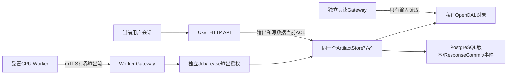

# Worker响应交付与共享存储写者

本切片把真实Worker产生的候选交付为用户可读取的不可变对象。ResponseCommit成功后，Job.execution_state为succeeded；settlement_state仍为pending，wallet不变化。响应提交、可信计量、账本结算及云端资源回收是不同事实，本切片不把供应方native_usage当扣费依据，也不释放云端未确认的执行占用。

## 协议和权限

Hello/Welcome独立协商output_version1，要求既有输入、执行与续期能力。没有真实writer的Gateway拒绝此能力，不静默降级。原Completion/OutputChunk草案仍不被当作新的提交接口。

`CommitOutput`为客户端流：首帧OutputHeader携带原session、upload_id、准确accepted ACK、完整字节SHA/长度及response_digest；后续最多64帧，每帧非空、最多32768字节、offset连续，整个UTF-8 JSON不超过1048576字节。服务端保持单帧64KiB gRPC限制。header摘要绑定原Assignment/Lease、journal、Broker grant/epoch/generation、模型请求和完整响应。

Worker不会取得用户Cookie，也不伪造ArtifactActor。Gateway从实际TLS对端和当前session取得设备身份；输出owner/creator从原Job推导。每次数据库决策检查当前节点/会话/epoch/fence、原ACK、执行期限、Job、审核模型、预算及原输入授权；输出对象自身的当前写ACL也独立检查。

完整JSON必须通过严格重复键检查、ResponseCandidate解析、终止状态/唯一工具ID/规范参数投影验证。工具名必须属于原GenerateRequest，参数必须为object；这仍然是未执行的模型数据，真正Agent宿主还必须验证工具参数和取得批准。finish_reason不是支持的完整终止状态时不发布。

## 持久化和发布

PG0022记录不可修改的Job输出绑定与ResponseCommit；0023用组合外键强制Job→artifact→精确version关系，防止未来代码混用有效ID。此前迁移不改字节。

写入复用原ArtifactStore的独占writer锁、4个I/O槽、8个受管待处理任务、quota、条件创建和唯一staging/published键。准备阶段按节点授权→capacity→源artifact顺序取锁，避免与源删除的capacity/artifact顺序相反。没有数据库事务跨对象I/O。

实际字节完成后校验SHA/长度、读取并校验原输入、验证响应结构，再复制和回读published文件确认内容；之后重新检查权限与期限，在一个事务中建立available版本、业务pin、不可变ResponseCommit、Job succeeded及持久事件/outbox。已提交的响应重传只能返回原事实，不生成第二个版本/事件或第二次模型效果。失败或不确定I/O保持不可见并继续占用quota，按既有孤儿维护机制回收。

SQLite执行日志schema5在网络发送前保存唯一OutputHeader/摘要；不保存模型正文。只有已经记录computed_unsubmitted、准确候选摘要及实际本机清理确认的执行才能准备上传。发送不确定后不能创建新upload身份。

`QueryOutput`使用当前output-capable设备会话查询原Header，核对原绑定、当前数据权限及实际对象SHA；它可恢复已提交事实，不续期旧Lease，不恢复执行或重新生成模型。Worker重启将prepared记录改为unknown，仅查询原提交。若没有已提交回执或权限已失效，则保守报错，不能把unknown自动重放成成功。

## 用户读取与删除

OpenAPI artifacts版本0.1.2增加 `GET /api/v1/owners/{owner}/jobs/{job}/result`，返回精确ArtifactView。再通过已有version_id绑定的content接口获取实际字节；响应仍是no-store/attachment/octet-stream，不把模型文本当可执行HTML。

结果读取要求当前用户会话、输出资源ACL和原输入内容ACL。读取已提交结果不需要再次提交任务或消费预算的权限，因此已有内容权限的viewer可以读取历史结果；源删除或ACL撤销会阻止后续读取/下载批次和回执恢复。用户普通上传接口不能填充或替换Worker输出；用户仍可按当前写权限删除输出。

删除首先是权限隔离和墓碑，不等于立即物理擦除。现有Job输入/输出pin仍需后继终态/结算维护释放，不能宣称完整数据退出已经完成。

## 实际进程接线

`orange-user-api`在配置ORANGE_ARTIFACT_ROOT和ORANGE_WORKER_GATEWAY_CONFIG时，可同时提供User HTTP与mTLS Gateway，二者持有同一个ArtifactStore，绝不另开第二个writer。ORANGE_WORKER_GATEWAY_BIND可指定loopback端口，默认43104；TLS私有配置沿用原Gateway格式。两个listener、维护任务及受管I/O在退出时统一排空。独立`orange-worker-gateway`保持只读输入模式。

开发Worker配置新增commit_outputs，默认true。默认要求对端支持输出提交；显式false只用于旧只读联调，此时仍报告pending_output_commit并在关闭时丢弃候选，不能当作已交付。新诊断事件response_committed/response_commit_recovered仍不包含正文。实际Host不会在不确定输出之后重新运行同一个模型。

## 验证与未完成范围

`python3 scripts/check-worker-outputs.py`覆盖真实PG/mTLS/文件字节、分块、重复/并发、源删除/ACL、viewer权限、存储损坏、旧只读能力、实际DB延迟跨Lease回滚、JSON重复键/未请求工具拒绝与组合引用约束。候选、目录、价格和初始准入在这些协议测试中明确是夹具。

`python3 scripts/check-worker-host.py`另跑实际二进制与完整固定模型：真实结果交付、注入本机确认失败后的重启查询且模型实例不变、真实User API/Gateway双入口单writer、实际HTTP授权读取和退出后writer锁释放。身份测试会话、enrollment与目录/价格记录仍为开发夹具；不是新的真实OIDC登录或生产试点认证。

仍未完成：可信DR-01 token计量/正式报价组合、幂等账本结算、云端cleanup/attempt终态与再次调度、无提交结果的故障终结与释放、Job pin最终回收、全Web Agent/桌面云结果UI、生产身份/签名/跨平台/GPU认证。原始模型计数不能作为捷径；下一步应在交付提交前形成可信计量事实，再按原报价结算，并单独处理资源确认。
